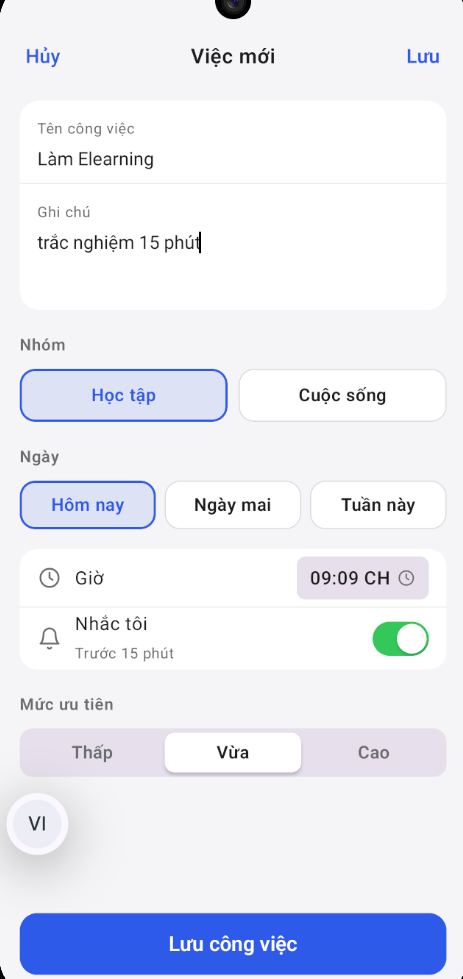

\# UTH Todo — Android Task Management App


# UTH Todo

**An Android task manager built with Kotlin, Jetpack Compose, and Firebase.**

UTH Todo helps users organize daily tasks, track completion progress, and stay on schedule. It combines a native Android interface with Firebase Authentication and per-user task storage in Cloud Firestore.

[**Download APK**](https://github.com/nguyendl8957/UTH-Todo/releases/latest) · [**GitHub Releases**](https://github.com/nguyendl8957/UTH-Todo/releases) · [**Google Drive download**](https://drive.google.com/file/d/1YLc9B3_ilNt3cmPmaETMS5C6riBsuX8q/view)

## App Preview

| Home | Add Task | Task Details | Settings |
|:---:|:---:|:---:|:---:|
|  |  |  |  |

## Features

- **Authentication:** Google, Email/Password, GitHub, and anonymous guest sign-in through Firebase Authentication.
- **Task management:** Create, edit, complete, and delete tasks and subtasks; set dates, times, categories, and priorities.
- **Cloud storage:** Store tasks in Cloud Firestore under each authenticated user's UID.
- **Reminders:** Schedule on-device Android notifications for upcoming tasks.
- **Progress:** View task completion progress and statistics.
- **Personalization:** Light/dark appearance, accent colors, and saved preferences.
- **Five UI languages:** Vietnamese, English, Simplified Chinese, Japanese, and Korean.
- **Persistent sign-in:** Return to the app without repeating sign-in while a valid session exists.

## Tech Stack

| Area | Technology |
|---|---|
| Language | Kotlin |
| UI | Jetpack Compose |
| Backend | Firebase Authentication, Cloud Firestore |
| Reminders | Android notifications, AlarmManager |
| Build | Gradle with Kotlin DSL |
| IDE | Android Studio |

## Data and Security

Task documents use the Firestore path:

```text
users/{uid}/tasks/{taskId}
```

Firestore Security Rules restrict task access to the authenticated user whose UID matches the path. Firebase configuration and signing keys are not included in this public repository.

## Run Locally

1. Clone the repository:

   ```bash
   git clone https://github.com/nguyendl8957/UTH-Todo.git
   ```

2. Open the project in Android Studio and sync Gradle.
3. Set up a Firebase project with Android application ID `com.example.uthtodo` (or adapt the project configuration for your own application ID).
4. Place the matching Firebase configuration in `app/google-services.json`.
5. Enable the required Firebase Authentication providers, set up Cloud Firestore and its user-scoped Security Rules, and configure the relevant OAuth credentials.
6. Run the app on an Android emulator or device.

> **Setup note:** A fresh clone requires your own Firebase configuration. OAuth providers may also need signing certificate fingerprints and provider-specific setup. Do not commit passwords, OAuth client secrets, or signing keystores.

## Release and Installation

**Latest stable release:** [v1.1.1](https://github.com/nguyendl8957/UTH-Todo/releases/tag/v1.1.1)

- [Download the signed Android APK from GitHub](https://github.com/nguyendl8957/UTH-Todo/releases/latest)
- [Alternative APK download via Google Drive](https://drive.google.com/file/d/1YLc9B3_ilNt3cmPmaETMS5C6riBsuX8q/view)

Install the APK on a compatible Android device. The signed release has a different certificate from the earlier debug build, so it generally cannot update that debug installation in place.

## Project Background and Credits

UTH Todo was developed for a mobile application development course at the **University of Transport Ho Chi Minh City (UTH)**. The interface is based on the instructor-provided UTH Todo Design Share prototype and adapted for native Android with Jetpack Compose. Firebase integration and Android-specific behavior are part of this application implementation.

## Author

**Đặng Lâm Nguyên**