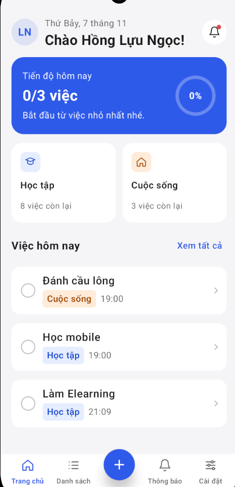
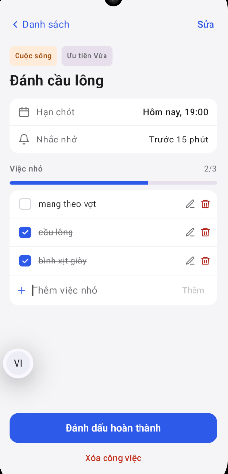
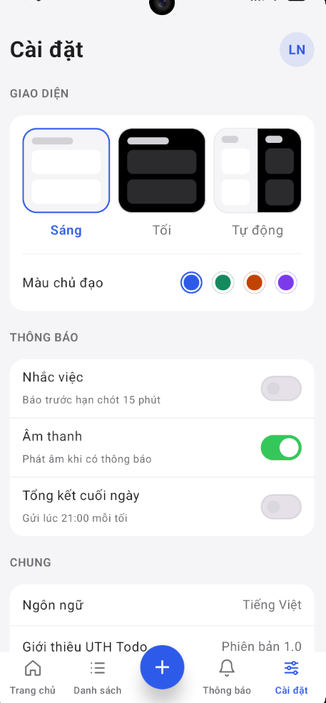

\# UTH Todo — Android Task Management App


\*\*A modern Android task management application built with Kotlin, Jetpack Compose, and Firebase.\*\*


UTH Todo helps users organize everyday tasks, track completion progress, and stay on schedule with reminders. The application supports multiple authentication methods, cloud data synchronization, customizable appearance, and multilingual interfaces.


\*\*\[Download Latest APK](https://github.com/nguyendl8957/UTH-Todo/releases/latest)\*\* · \*\*\[View Releases](https://github.com/nguyendl8957/UTH-Todo/releases)\*\* · \*\*\[Project Overview (PDF)](docs/UTH-Todo-Project-Overview.pdf)\*\*


\## App Preview


| Home | Tasks | Task Detail | Settings |

|:---:|:---:|:---:|:---:|

|  |  |  |  |


\## Key Features


\- \*\*Authentication:\*\* Google Sign-In, Email/Password, GitHub OAuth, and anonymous guest access using Firebase Authentication.

\- \*\*Cloud Synchronization:\*\* Store and synchronize personal tasks through Cloud Firestore.

\- \*\*Task Management:\*\* Create, edit, complete, and delete tasks and subtasks.

\- \*\*Reminders:\*\* Schedule local Android notifications for upcoming tasks.

\- \*\*Personalization:\*\* Light and dark themes, accent color options, and appearance preferences.

\- \*\*Multilingual UI:\*\* Vietnamese, English, Simplified Chinese, Japanese, and Korean.

\- \*\*Task Progress:\*\* Track task completion and view progress statistics.

\- \*\*Session Persistence:\*\* Keep users signed in between app launches.


\## Technology Stack


| Category                | Technology                                     |

| ----------------------- | ---------------------------------------------- |

| Language                | Kotlin                                         |

| UI Framework            | Jetpack Compose                                |

| Backend Services        | Firebase Authentication, Cloud Firestore       |

| Asynchronous Operations | Kotlin Coroutines / Firebase asynchronous APIs |

| Notifications           | Android notification system and AlarmManager   |

| Build System            | Gradle with Kotlin DSL                         |

| Development Environment | Android Studio                                 |


\## Data and Security


Tasks are organized under user-specific Firestore paths:


`users/{uid}/tasks/{taskId}`


Firestore Security Rules are used to restrict access based on authenticated user identity.


\## Getting Started


1\. Clone this repository:


&#x20;  ```bash

&#x20;  git clone https://github.com/nguyendl8957/UTH-Todo.git

&#x20;  ```


2\. Open the project in Android Studio.


3\. Configure a Firebase project and register an Android application with the appropriate application ID.


4\. Place your Firebase Android configuration file at `app/google-services.json`.


5\. Configure the required authentication providers and Firestore Security Rules.


6\. Sync Gradle and run the application on an Android device or emulator.


\*\*Note:\*\* The Firebase configuration used by the developer is not included in the public repository. Some authentication providers require additional Firebase or OAuth setup before they can be tested in another environment.


\## Download and Installation


\### Latest Stable Release — v1.1.0


UTH Todo is available as a signed Android APK.


\- \[Download APK from GitHub Releases](https://github.com/nguyendl8957/UTH-Todo/releases/latest)

\- \[Download APK from Google Drive](https://drive.google.com/file/d/1YLc9B3\_ilNt3cmPmaETMS5C6riBsuX8q/view)


Download the APK and install it on a compatible Android device.


> Note: This release is signed with a dedicated release key.

> It cannot normally be installed directly over the previous

> debug-signed version.


\## Project Background


UTH Todo was developed as an Android application project for a mobile application development course at the University of Transport Ho Chi Minh City (UTH).


The project explores native Android UI development, authentication, cloud data persistence, and mobile application lifecycle management.


\## Author


\*\*Đặng Lâm Nguyên\*\*


GitHub: \[@nguyendl8957](https://github.com/nguyendl8957)


\## Release


\*\*Latest stable release:\*\* \[v1.1.0](https://github.com/nguyendl8957/UTH-Todo/releases/tag/v1.1.0)


The release APK is signed for distribution. Future updates must use a compatible signing key.


